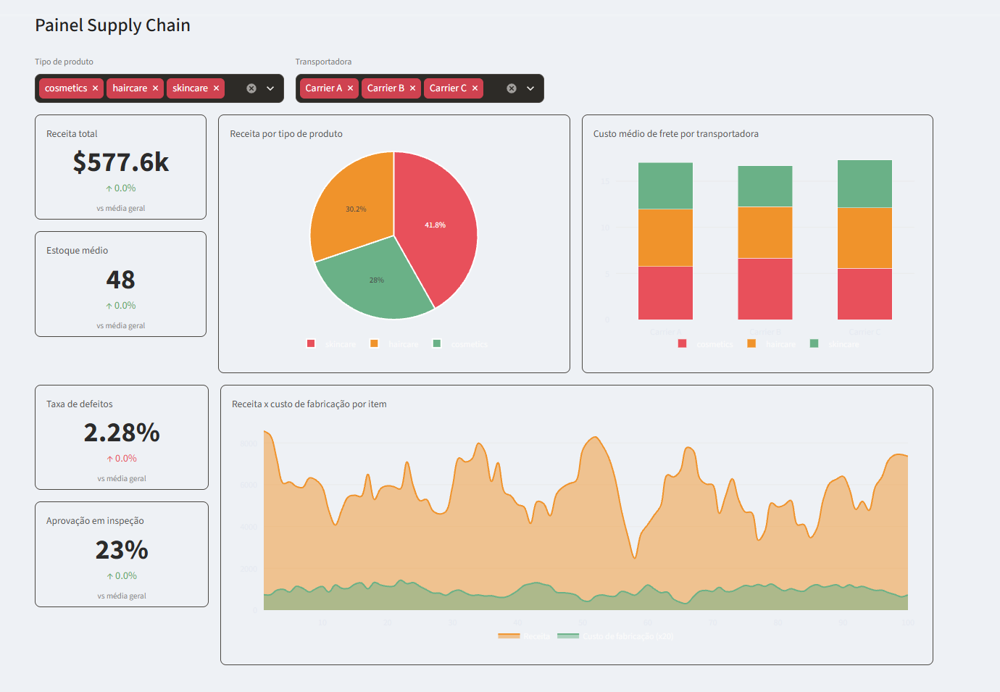

# Painel de Análise - Supply Chain

Dashboard interativo de análise de uma cadeia de suprimentos, com filtros na barra lateral e gráficos em Plotly, construído com Streamlit.



## Tecnologias

Python, Pandas, Plotly e Streamlit.

## Dataset

[Supply Chain Analysis - Kaggle](https://www.kaggle.com/datasets/harshsingh2209/supply-chain-analysis): 100 registros com produtos, estoque, frete, fornecedores e inspeções de qualidade.

O arquivo está em data/supply_chain_data.csv.
Ou baixe o CSV no Kaggle e salve em `data/supply_chain_data.csv`.

## Análises

- Receita total por tipo de produto
- Estoque médio por tipo de produto
- Taxa de defeitos por tipo de produto
- Custo médio de frete por transportadora
- Distribuição dos resultados de inspeção

## Como rodar

```bash
git clone https://github.com/guto-henrique/supply-chain-dashboard.git
cd supply-chain-dashboard

python -m venv .venv
# Windows
.venv\Scripts\activate
# Linux/macOS
source .venv/bin/activate

pip install -r requirements.txt
streamlit run app.py
```

O dashboard abre no navegador em `http://localhost:8501`.